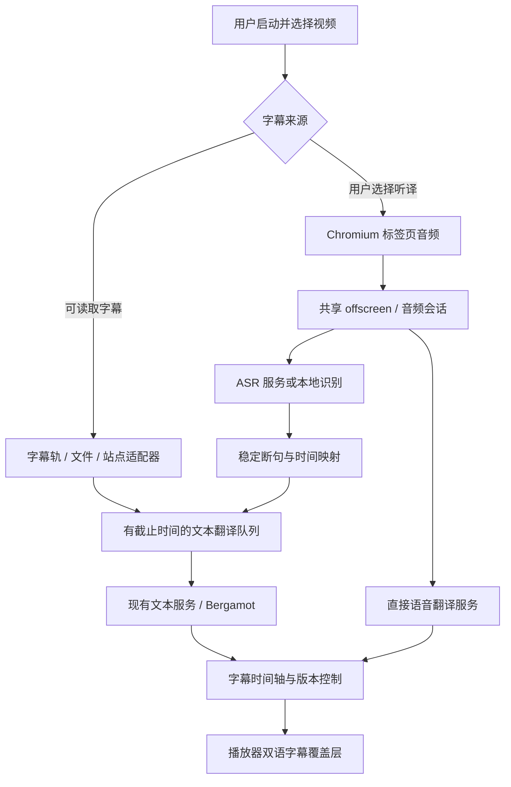

# 实时视频翻译可行性调研

[返回开发指南](../development.md)

调研日期：2026-10-28。基于 WuPage 1.4.0、提交 `9449537f929a7870ca61adf7813ff983bdb7bd17`，调研分支为 `codex/research-realtime-video-translation`。

本文是开发前的技术调研与实施建议，尚未实现视频翻译原型，也未调用付费语音服务。包体基线来自本机构建；新增体积、性能预算、延迟目标与工期均不是功能实测。服务能力与价格按本次查阅的官方资料记录，接入前需复核区域、账号权限、语言与最新计费。

## 1. 结论与推荐范围

功能可行，建议以“双语字幕”为第一阶段的产品形态，按以下顺序推进：

| 路线 | 能覆盖的内容 | 难度（1–5） | 主要代价 | 建议 |
| --- | --- | --- | --- | --- |
| 翻译已有字幕 | 可读取的字幕轨、字幕文件或已适配的播放器字幕 | 2–3 | 字幕提取、时间轴、站点适配；复用文本翻译服务 | 第一阶段 |
| 标签页音频 → 云端语音识别（ASR）→ 文本翻译 | 无字幕视频、直播；优先 Chrome/Edge | 4 | 新增音频采集、ASR、持续连接和字幕调度；按时长收费 | 第二阶段 |
| 音频 → 云端直接翻译 | 服务商支持的语言组合 | 3–4 | 仍需采集与同步；依赖专用实时翻译接口及认证设施 | 与第二阶段同批验证 |
| 音频 → 本地 ASR → 文本翻译 | 模型支持的语言和性能足够的设备 | 5 | 模型下载、数百 MB 以上内存、CPU/GPU 与耗电 | 后续实验选项 |
| 实时译音/配音 | 需要听译音的用户 | 5 | 增加语音合成、音量混合、回声和音画同步问题 | 独立后续功能 |

推荐的首版包括：用户手动启动、选择视频、原文/译文双语显示、暂停/停止、拖动进度与倍速适配、清理会话。已有字幕优先；只有在用户选择听译并确认服务配置后才采集音频。默认一次处理一个标签页中的一个视频。

有字幕路线的目标是对齐原字幕时间轴；无字幕路线的目标是容忍数秒延迟的实时字幕。无字幕识别需要已播放的语音和后续语境，不能承诺所有场景下“零延迟同传”。若要求译文与原声严格同时出现，需要额外缓冲播放；普通网页扩展很难对所有第三方播放器统一实现。

## 2. 功能边界

### 2.1 已有字幕翻译

优先读取 `HTMLMediaElement.textTracks` 中的 `TextTrack`、cue 和起止时间。对未启用的字幕轨，需在不改变用户显示选择的前提下验证 `hidden` 模式的加载行为。提前翻译未来 15–30 秒的字幕，按播放器 `currentTime` 显示；回看使用缓存。标准接口不能保证每个网站都暴露字幕。[MDN：textTracks](https://developer.mozilla.org/en-US/docs/Web/API/HTMLMediaElement/textTracks)

YouTube、Bilibili 等播放器应作为独立适配器调研对象。站点可能把字幕保存在播放器内部状态、独立接口或动态 DOM 中；不能仅凭页面存在 `<video>` 就承诺可读取字幕。页面脚本桥接只能传递经校验的字幕与播放状态，密钥和扩展权限留在扩展侧。

YouTube 官方 `captions.download` 要求请求者拥有视频编辑权限，因此不能将它作为下载任意公开视频字幕的通用接口。未公开的播放器接口还会受登录、签名、接口变动与使用条件影响，首版支持名单需经过实际页面验证。[YouTube：Captions download](https://developers.google.com/youtube/data/reference/rest/v3/captions/download)

可增加用户导入 SRT/WebVTT，作为稳定且不依赖站点字幕接口的入口。导入后仍需用户选定视频，并允许校正字幕偏移量。

### 2.2 无字幕实时听译

只采集音频，不传输视频帧。流程是：标签页音频 → 降混/重采样 → ASR 或直接语音翻译 → 断句与译文调度 → 页面字幕覆盖层。默认不读取麦克风，也不录制或长期保存音频。

标签页采集会包含该页其他音源，例如广告、通知声和第二个播放器，不能天然隔离用户选中的视频。首版需要提示这一限制，并暂停处理广告切换等可识别的状态；对多播放器混音不能宣称已解决。

烧录在画面中的硬字幕属于另一条 OCR 路线，需要持续提取画面、去重与定位；目前的图片 OCR 是单次任务，不能据此推定可低成本持续识别视频。它也不能代替无字幕视频的语音识别，不纳入首版。

### 2.3 首版不覆盖的场景

原生画中画窗口通常不会显示网页 DOM 覆盖层，需要独立字幕窗或专门的画中画方案；浏览器原生视频全屏也需与元素全屏区分。付费/DRM 播放器、跨域 iframe、封闭 Shadow DOM 和桌面其他应用均不作为通用覆盖承诺。不能从标签页采集 API 推导出所有受保护内容都能采集。

## 3. 与现有代码的关系

| 现有位置 | 可复用内容 | 需要补充的能力 |
| --- | --- | --- |
| `src/background/providers.ts` | HTTP、LLM、在线翻译及 Bergamot 文本服务适配 | ASR/直接语音翻译需独立接口；文本兼容服务不等于支持音频 |
| `src/background/translation.ts` | `translateWithSettings`、缓存、批处理、服务商限流 | 字幕任务截止时间、优先级、过期任务取消，避免排在长篇网页翻译后面 |
| `src/shared/types.ts` | `TranslateBatchRequest`、`TranslatorProvider`、消息类型 | 视频设置、会话、带时间戳的字幕与 partial/final 结果 |
| `src/background/offscreen.ts`、`src/ocr/offscreen.ts` | Chromium 的共享 offscreen、现有推理宿主 | 音频采集宿主、连接管理及共同的生命周期协调 |
| `src/local/model-store.ts`、`src/local/models.ts` | 模型校验、下载续传、离线导入和删除的设计 | ASR 专用模型目录、推理 Worker 与独立资源上限 |
| `src/content/index.ts`、`src/content/runtime.ts` | 页面初始化、消息通信 | 视频发现、播放器适配、字幕覆盖和会话控制 |
| `src/options/`、`src/shared/settings.ts` | 设置持久化和服务配置界面 | 语音服务独立配置、目标语言、资源与用量提示 |
| `public/manifest.json`、`build/manifest.ts` | Chromium/Firefox 构建差异处理 | Chromium 采集权限、按浏览器隐藏能力及数据传输声明复核 |

必须处理的现有约束：

- 当前文本服务采用完整请求/响应；高级模板明确拒绝 `stream: true`。逐句发送完整文本已经能做字幕翻译，不必先把全部 LLM 服务改成流式；ASR 自身的持续流协议则必须新增。
- `providers.ts` 的网页/API/LLM 超时分别为 20/45/90 秒，且有恢复重试。实时任务不能照搬这些等待时间。虽然底层 `translateBatch` 接受 `AbortSignal`，当前 `translateWithSettings` 并未向整条链路传递会话取消信号，需要补齐。
- 当前缓存和调试任务会保存原文与译文，调试列表最多保留 100 项。听译应默认使用有上限的会话内缓存，避免让持续转写隐式进入现有持久缓存和调试记录。
- Manifest 当前只向默认顶层页面注入内容脚本。跨域 iframe 播放器需要明确的 frame 选择与消息路由；不应直接把所有页面改成全 frame 自动扫描。
- 现有 OCR ONNX Runtime 是裁剪后的 WASM，算子列表见 `vendor/ocr/required-operators.config`，且 `src/ocr/ort-runtime.ts` 使用 `onnxruntime-web/wasm`。不能因已依赖 ONNX Runtime 就认定 Whisper 或 WebGPU 可直接复用；需重新验证算子、执行后端与构建产物。

## 4. 浏览器与权限

| 能力 | Chrome/Edge | Firefox | 实施判断 |
| --- | --- | --- | --- |
| 标准字幕轨与 DOM 字幕显示 | 可行，需页面适配 | 可行，需页面适配 | 第一阶段共用核心逻辑 |
| `tabCapture` + offscreen 后台采集 | Chrome 116 起支持相应服务工作线程到 offscreen 的流转；Edge 需实机验证 | 没有已确认的同等 `tabCapture` 路径 | 听译首版优先 Chromium |
| `getDisplayMedia({ audio: true })` | 由用户选择共享对象；是否有音频依赖对象、系统和实现 | MDN 兼容数据仍将音频捕获标记为不支持 | 不能用屏幕共享接口统一解决两端音频采集 |
| `<video>.captureStream()` | 接口与媒体来源有限制 | 可作为符合条件的视频的实验路径 | 必须验证来源、轨道与切源行为，不能作为全站保证 |
| 浏览器内置 Web Speech | 可实验 `start(audioTrack)`；本地模式需语言包和能力检测 | 跨浏览器支持不足 | 可另做实验适配器，不作为稳定免费 ASR 基线 |

依据：[Chrome 音频采集指南](https://developer.chrome.com/docs/extensions/how-to/web-platform/screen-capture)、[tabCapture](https://developer.chrome.com/docs/extensions/reference/api/tabCapture)、[MDN 屏幕音频兼容数据](https://github.com/mdn/browser-compat-data/blob/main/api/MediaDevices.json)、[captureStream](https://developer.mozilla.org/en-US/docs/Web/API/HTMLMediaElement/captureStream)、[SpeechRecognition.start](https://developer.mozilla.org/en-US/docs/Web/API/SpeechRecognition/start)、[本地语音识别能力检测](https://developer.mozilla.org/en-US/docs/Web/API/SpeechRecognition/available_static)。

Chromium 听译需要新增 `tabCapture` 权限；优先评估按需申请的可选权限，获取权限和启动采集均由用户操作触发。现有 `activeTab`、`offscreen` 不替代 `tabCapture`。Firefox 构建需过滤不支持的权限并显示实际可用的功能。

采集后的声音需要经 `AudioContext` 接回播放输出，否则标签页原声可能停止。停止、错误、页面关闭和扩展重载时要释放音轨、音频节点与连接，并验证原声恢复。[Chrome：tabCapture 的声音播放行为](https://developer.chrome.com/docs/extensions/reference/api/tabCapture)

每个扩展运行环境只能同时存在一个 offscreen 文档。本项目已用于 OCR、本地翻译和词典音频，不能再独立创建第二个视频 offscreen。音频应复用统一宿主，创建理由加入符合实际用途的 `USER_MEDIA`；若既有文档先创建，要在没有活动任务时协调重建，或统一预声明实际需要的理由。`AUDIO_PLAYBACK` 在无音频播放 30 秒后可能触发生命周期限制，长静音、暂停和并发 OCR 需专门验证。[Chrome：offscreen](https://developer.chrome.com/docs/extensions/reference/api/offscreen)

## 5. 需要接入的服务

### 5.1 路线选择

| 方案 | 新增外部服务与配置 | 是否额外调用文本翻译 | 浏览器接入与主要限制 |
| --- | --- | --- | --- |
| 已有字幕翻译 | 复用用户已配置的 WuPage 文本翻译服务；也可用已安装的 Bergamot 模型 | 是 | 无需 ASR；本地文本翻译受当前语言方向限制 |
| Deepgram Nova-3 ASR | Deepgram 账号、语音模型和语言；生产环境推荐短期令牌签发服务 | 是 | 官方支持浏览器 WebSocket 子协议认证，可直传音频；语音结果包含时间信息，适合字幕调度 |
| Azure Speech Translation | Azure Speech 资源、区域、密钥/令牌；可引入官方 JS SDK | 直接翻译路线不需要 | 官方支持连续翻译及文本结果；可通过音频流输入。生产共享凭据需令牌服务；SDK 必须本地打包并测量体积 |
| 火山/豆包流式 ASR | 语音应用、语音凭据、资源 ID，以及 WebSocket 中转服务 | 是 | 官方 WebSocket 需要自定义认证头，不能直接照搬 Node/Python 示例到原生浏览器 WebSocket；还要处理二进制协议 |
| OpenAI 实时转写 | `gpt-live-transcribe`，浏览器采用短期凭据/WebRTC 路线 | 是 | 返回文字增量；需客户端断句/提交，不支持该模型的服务端 VAD；无词级时间戳和说话人标签，需应用侧时间映射 |
| OpenAI 直接实时翻译 | `gpt-realtime-translate`，短期凭据签发服务及 WebRTC | 不需要 | 专用翻译端点返回译音和文字增量；仅显示文字不等于可免除译音相关资源与收费 |
| 阿里云百炼直接实时翻译 | `qwen3.8-livetranslate-flash-realtime`、业务空间与区域、API Key；选定认证网关或中转方式 | 不需要 | 官方支持仅文本输出；WebSocket 示例依赖 `Authorization` 头，浏览器直连须另验证官方 WebRTC/短期凭据能力 |
| 本地 ASR | 浏览器 Worker/WASM/WebGPU 模型，或用户运行的本地 ASR 服务 | 通常需要，可复用 Bergamot | 无云端语音费；增加模型、设备要求或本地服务安装成本；本地服务不属于扩展 ZIP |

服务依据：[Deepgram Live Audio](https://developers.deepgram.com/reference/speech-to-text/listen-streaming)、[Deepgram 临时令牌](https://developers.deepgram.com/guides/fundamentals/token-based-authentication)、[Azure Speech Translation](https://learn.microsoft.com/en-us/azure/ai-services/speech-service/speech-translation)、[Azure 音频流输入](https://learn.microsoft.com/javascript/api/microsoft-cognitiveservices-speech-sdk/audioconfig)、[火山流式 ASR 协议](https://docs.volcengine.com/docs/doubao-voice/large-model-streaming-automatic-speech-recognition-api-1?lang=zh)、[OpenAI 实时转写](https://developers.openai.com/api/docs/guides/realtime-transcription)、[OpenAI 实时翻译](https://developers.openai.com/api/docs/guides/realtime-translation)、[百炼实时翻译模型](https://help.aliyun.com/zh/model-studio/qwen3-8-livetranslate-flash-realtime)、[百炼接入指南](https://help.aliyun.com/zh/model-studio/qwen3-5-livetranslate-flash-realtime)。

**首轮只验证两类服务**：一个 ASR 加现有文本翻译的组合，以及一个直接语音翻译服务。国内部署可先比较豆包 ASR 和百炼文本输出；其他部署可先比较 Deepgram ASR 和 Azure 直接翻译。选择依据应是目标用户实际网络、英/日/中等目标语言样本、稳定译文延迟、价格和认证部署成本，而非仅比较厂商宣传的首字延迟。

现有 Microsoft、火山、OpenAI 兼容文本配置不代表已开通语音产品；语音资源、模型、区域、认证字段及配额应单独配置。无需为字幕首版引入 TTS、RTC 房间服务、视频理解服务或视频帧上传。

### 5.2 是否需要自建后端

已有字幕翻译可继续沿用当前架构。语音路线取决于所选服务的浏览器认证方式：

- **令牌签发服务**：长期服务密钥留在服务器，只签发受限的短期凭据；音频由浏览器直达语音厂商，后端不必承载持续音频流。适合明确支持浏览器传输的服务。
- **完整 WebSocket 中转**：扩展连接自有服务，由其添加厂商要求的认证头并转发音频。适合需要自定义握手头或二进制协议转换的接口；增加带宽、连接数、运维和音频数据处理责任。
- **用户自己的凭据**：可延续 BYOK 的产品方式，但凭据仅保存在扩展受信任上下文，不能发送到网页、写入日志或打包进扩展。BYOK 也不能消除浏览器 WebSocket 不能任意设置请求头的限制。OpenAI 官方浏览器示例使用服务器签发短期凭据；本次不假定扩展存储长期密钥即可直接套用该示例。

中转服务必须鉴权、限制单用户并发和会话时长，并处理断开与上游停止；不能部署成任何人可用的匿名转发地址。选用服务器中转时需使用能承担持续连接的部署方式，不能只按普通短 HTTP 请求估算。

## 6. 成本与流量

### 6.1 服务成本

以下按单个目标语言、60 分钟实际发送音频计算，不含税费、网络、后端、文本翻译和额外功能；实际计费可能包含发送的静音以及服务最小计费单位。

| 服务 | 本次查阅的公开价格 | 60 分钟预算 | 注意事项 |
| --- | --- | --- | --- |
| Deepgram Nova-3 单语流式 | 当前促销 $0.0048/分钟；页面常规价 $0.0077/分钟 | $0.288；按常规价为 $0.462 | 仅 ASR；多语流式当前 $0.0058/分钟，即 $0.348/小时；上线预算应考虑促销结束 |
| 豆包流式语音识别模型 2.0 | 官方计费资料索引显示后付费 1 元/小时 | 约 1 元 + 文本翻译 | 价格正文为动态页面，本次不能完整提取；作为待控制台复核的预算值，不作为承诺报价 |
| OpenAI `gpt-live-transcribe` | $0.017/分钟 | $1.02 + 文本翻译 | 实时转写模型；不能用其他离线转写模型价格替代 |
| OpenAI `gpt-realtime-translate` | $0.034/分钟 | $2.04 | 直接翻译；多目标语言需按会话数扩大预算 |
| 百炼 `qwen3.8-livetranslate-flash-realtime` | 北京：音频输入 40 元/百万 token、文本输出 100 元/百万 token；音频输出 160 元/百万 token | 按实际 token 用量计算 | 首版选 `output_modalities: ["text"]`；不在缺少实际音频 token 用量时硬换算每小时价格 |
| Azure 标准 Speech Translation | F0 页面列出每月 5 音频小时；付费金额依区域/套餐 | 付费值待控制台报价 | 本次公开页面金额显示 `$-`，不采用未经核实的固定单价；F0 仍需开通资源且受配额限制 |
| 本地 ASR | 无按分钟云端语音费 | 电耗、硬件及可选本地服务成本 | 若文本翻译使用在线服务，仍有文本翻译费用 |

价格来源：[Deepgram](https://deepgram.com/pricing)、[豆包语音计费](https://docs.volcengine.com/docs/doubao-voice/billing-instructions?lang=zh)、[OpenAI 实时转写模型](https://developers.openai.com/api/docs/models/gpt-live-transcribe)、[OpenAI 实时翻译模型](https://developers.openai.com/api/docs/models/gpt-realtime-translate)、[百炼模型价格](https://help.aliyun.com/zh/model-studio/qwen3-8-livetranslate-flash-realtime)、[Azure Speech 价格](https://azure.microsoft.com/en-us/pricing/details/speech/)。价格快照日期为 2026-10-28。

文本翻译还需单独计费。以一小时英语语音为例，假定 150 词/分钟、每词含空格平均 6 字符，约为 `150 × 60 × 6 = 54,000` 个源字符。按字符计费时，费用为 `54,000 / 1,000,000 × 每百万字符单价`；按 token 计费时，费用为 `输入 token × 输入单价 + 输出 token × 输出单价`。系统提示、历史上下文和重复翻译的 partial 都会增加用量，不能只把原文字符数当作全部输入 token。

建议仅将断句后稳定文本送往普通翻译服务；partial 用于原文预览。若需要提前译文，限制更新频率并给同一句分配 revision，最终结果替换旧结果。内置免费网页翻译接口没有可保证的持续调用配额，不能作为长时间听译的可靠成本承诺。

### 6.2 音频上传流量

以下是可复算的音频负载计算，不包含 TLS、WebSocket、JSON、重传和控制消息：

| 格式 | 负载速率 | 每小时音频负载 |
| --- | --- | --- |
| 16 kHz、单声道、PCM16 二进制 | `16,000 × 1 × 2 = 32,000 B/s`，约 256 kbit/s | 115.2 MB（约 109.9 MiB） |
| 24 kHz、单声道、PCM16 二进制 | 48,000 B/s，约 384 kbit/s | 172.8 MB（约 164.8 MiB） |
| 上述 16 kHz PCM 采用 base64 | 约扩大到 4/3 | 153.6 MB（约 146.5 MiB） |
| 上述 24 kHz PCM 采用 base64 | 约扩大到 4/3 | 230.4 MB（约 219.7 MiB） |
| Opus 目标码率 24–48 kbit/s | 仅在服务支持对应编码/容器时采用 | 约 10.8–21.6 MB |

OpenAI 当前实时 WebSocket 文档使用 24 kHz PCM16/base64；不能统一按 16 kHz 估算所有服务。[OpenAI 实时转写音频格式](https://developers.openai.com/api/docs/guides/realtime-transcription)

以 16 kHz PCM 二进制、100 个用户同时听译一小时为例，中转服务会接收约 11.52 GB 音频，再向上游发送约 11.52 GB，且维持约 200 条两端 WebSocket 连接。实际账单取决于部署商如何收取入站/出站流量；若走 base64、24 kHz 或返回译音还需增加预算。只签发令牌、浏览器直传时，自有服务不承担这部分持续音频流量。

VAD（语音活动检测）有助于断句，但不能假定“静音时不发送就一定减少收费”：有的持续流协议要求保持连续音频，暂停过长会超时，部分服务按会话计费。暂停视频时应停止识别会话或按厂商协议处理，再统计实际账单验证。

## 7. 插件体积、内存与性能

### 7.1 当前包体基线：已实测

在上述提交执行 `npm run build`，统计 `dist/` 内普通文件，排除 `.map`。使用 Python `zipfile`、DEFLATE level 6 在内存中打包同一批文件估计压缩体积；本地 ZIP 头和压缩实现与发布环境可能不同，因此不是 GitHub Release 附件的精确字节数。

| 指标 | 字节数 | 换算 |
| --- | --- | --- |
| Chromium 构建文件数 | 47 个 | 默认无 source map |
| 安装目录文件总大小 | 16,704,223 B | 15.930 MiB |
| 本地 ZIP 估计 | 5,464,100 B | 5.211 MiB |
| OCR 的 ONNX Runtime WASM | 6,875,056 B | 6.556 MiB |
| Bergamot WASM | 5,174,294 B | 4.934 MiB |
| OpenCV WASM | 1,222,424 B | 1.166 MiB |
| 内容脚本 `content.js` | 177,196 B | 173.043 KiB |

该基线不含首次下载的 OCR/Bergamot 模型、浏览器磁盘缓存、运行内存和视频本身。Chrome/Edge 使用同一套构建；本次未重新构建和测量 Firefox 包。

### 7.2 新增资源预算：待原型验证

下表用于约束方案，不代表已测到的增量。ZIP 为相对现有构建的压缩后增量；内存需用同一浏览器、同一视频开启/关闭功能作差，并统计内容页、后台、offscreen 和 Worker，不能只看 JS heap。

| 路线 | 新增 ZIP 预算/判断 | 模型磁盘 | 运行资源预算/判断 |
| --- | --- | --- | --- |
| 已有字幕 + 在线文本翻译 | 目标 50–150 KiB，包含控制、解析与覆盖层 | 无新增模型 | 目标额外内存 ≤20 MiB；cue 事件驱动，避免每帧遍历整页 |
| 云端 ASR + 文本翻译，使用原生流协议 | 相对基线合计目标 100–300 KiB；不打包大型 SDK/媒体工具链 | 无语音模型 | 初始额外内存预算 50–150 MiB，含宿主/音频处理；需实测收紧 |
| 官方语音 SDK | 不预设固定大小；需对选定版本做实际 bundle/ZIP 对比 | 一般无语音模型 | SDK、连接与音频处理资源随实现变化；超预算时再评估原生协议 |
| 浏览器本地 ASR | 可能需新增数 MiB 到数十 MiB 的推理运行库；准确值取决于后端/裁剪，待构建 | 模型单独按需下载，不随默认包分发 | 原型需测 RAM、GPU 显存、RTF 和耗电；不能只报告模型文件大小 |
| 用户运行本地 ASR 服务 | 扩展只增加适配器，具体值待构建 | 模型、运行环境在本地服务侧 | CPU/GPU 消耗移到独立进程，整体设备消耗并未消失 |

云端路线的工作主要是音频采集、重采样、网络和字幕绘制，避免本机持续神经网络推理，预期比本地 ASR 更轻；但尚无本项目性能数据，不能承诺固定 CPU 百分比。

本地模型量级参考 `whisper.cpp` 官方示例：tiny 文件约 75 MiB、内存约 273 MB；base 142 MiB、约 388 MB；small 466 MiB、约 852 MB。它们是该项目原生实现的参考数据，不是浏览器 Whisper/ONNX 的测量；浏览器还可能产生模型复制、音频特征、解码器缓存和 GPU 缓冲开销。量化可降低模型大小，但必须连同质量验证。[whisper.cpp：Memory usage](https://github.com/ggml-org/whisper.cpp#memory-usage)

本地 ASR 初步按 0.5–1.5 GiB 额外内存为 tiny/base 路线预留测试空间，仍需按设备测量，不能作为设备最低要求。再叠加 Bergamot 文本翻译时，其模型和数百 MB 级潜在运行内存也要计入；CPU ASR 与本地翻译应避免同时争满线程。完全离线必须同时满足语音模型和文本模型都已安装。

### 7.3 控制性能与长期资源增长

- **音频**：在 offscreen 的 `AudioWorklet`/Worker 中处理音频；不在网页主线程做特征提取。按服务要求选择采样率，先降混再重采样，不能将 48 kHz 数据仅改元数据冒充 16 kHz。
- **消息**：原始音频不经 `chrome.runtime` 在多个上下文反复 JSON/base64 复制；优先由持有音轨的宿主直连服务或中转。字幕结果再传回页面。WebRTC 路线直接发送音频轨，不额外人为转成 PCM/base64。
- **缓冲**：建议原始重采样 PCM 环形缓冲上限 10 秒；16/24 kHz 单声道 PCM16 分别约 0.32/0.48 MB，不含音频系统自身缓冲。断网不能无上限缓存音频，积压超过阈值应停止并明确标记缺口。
- **翻译调度**：一个会话默认 1 个活跃文本翻译任务，队列按媒体时间设上限；过期内容不继续重试。与网页翻译共用服务商时仍要遵守总限流，并提供实时任务优先策略。
- **渲染**：只更新变化的字幕，用 cue/播放事件驱动；限制当前原文和译文行数。对局部动态 DOM 使用窄范围观察，避免持续扫描页面和反馈触发网页翻译。
- **存储与退出**：字幕采用有上限的 LRU/会话内缓存，不保存原始音频。显式停止后立即停止采集和上游音频发送、取消排队任务，允许有界的最终结果收尾；按引用计数释放共享宿主，避免中断 OCR/词典。

RTF（real-time factor）定义为“推理耗时 / 被识别音频时长”；持续识别必须长期小于 1，建议把原型门槛设为 RTF p95 ≤0.7，留下翻译、视频解码和系统负载余量。倍速播放时应按墙钟时间重新计算负载，不能用离线一段音频的平均速度证明 2 倍速连续播放可行。

## 8. 建议架构与关键难点

1. **媒体时间与采集时间不同**：音频服务返回的偏移量一般从识别会话开始计算，而视频可以跳转、暂停、倍速。每段音频需要对应的媒体时间锚点和播放速率；`seeking`、换视频、源语言或目标语言变化时增加 `epoch`，丢弃旧结果。不能只用“当前视频时间减固定延迟”对齐所有结果。
2. **语句会被修改**：ASR partial 可能回退或改词，完成事件可能乱序。字幕模型建议含 `sessionId/epoch/segmentId/revision/start/end/text/final`，按 ID 与版本更新，避免重复翻译和错位。没有词级时间戳的服务只能先采用句级映射，并明确精度限制。
3. **全屏覆盖**：普通全屏需要把字幕层放在实际 fullscreen 元素的合适容器；若 fullscreen 元素本身是 `<video>`，DOM 叠层可能不可见，要单独设计回退。字幕点击不应阻断播放器操作；原文和译文按文本插入，不能把服务输出作为 HTML 注入。
4. **站点导航与来源**：处理 SPA 换集、广告、iframe、多个视频和字幕轨变化。标准接口作为核心，站点差异隔离在适配器；每个站点都维护可复现样本和回归步骤。
5. **生命周期与失败**：popup 关闭不应终止会话，标签页关闭则必须停止；连接重建、令牌过期、服务限额、后台重启与系统休眠都需可恢复的状态机，且不能悄悄积压收费任务。
6. **质量**：音乐、多人重叠、口音、专业词和语言切换会影响 ASR；缺少上下文会影响翻译。维护一个有上限的近期上下文窗口与术语表，实际评测质量和延迟，避免每句都发送全部历史。

建议新增模块（均为后续实施设计，当前未创建）：`src/video/` 保存会话/字幕/适配器类型，`src/content/video/` 保存播放器发现与覆盖层，`src/background/video.ts` 处理控制与调度，音频与流式服务放在共享运行宿主对应模块；设置页另加视频和语音服务配置。第一阶段不修改通用文本服务的数据含义。

## 9. 分阶段工作量

按一名熟悉本仓库的开发者估算，1 人日约为 1 个完整工作日；不包含外部账号开通、审核、真实服务等待及长期站点维护。以下为顺序增量，站点适配、后端和离线支持会扩大范围。

| 阶段 | 交付与完成条件 | 估算 |
| --- | --- | --- |
| P0 技术验证 | 标准字幕样本；Chrome/Edge 采集、原声恢复及共享宿主验证；选定两类语音服务做小样本比较 | 2–3 人日 |
| P1 已有字幕 MVP | 标准字幕轨 + SRT/VTT 导入、双语覆盖、预取/缓存、跳转/倍速、设置及核心回归 | 6–10 人日 |
| P2 无字幕听译 | Chromium 采集、一种语音服务、稳定断句、时间映射、限流/取消、连接恢复、用量和停止控制 | 12–20 人日；含简单认证/中转接入，不含完整商业后端 |
| P3 发布前稳定性 | 两个 Chromium 浏览器的实机测试、长视频、低配机器、全屏与错误场景；Firefox 已有字幕回归 | 8–12 人日 |
| 单个站点适配 | YouTube/Bilibili 等逐个验证字幕来源、导航、广告、全屏和变动风险 | 每站约 2–5 人日，复杂站点另估 |
| 本地 ASR 实验 | 模型/后端选择、下载/校验、Worker、性能分级、精度评测 | 额外 15–30 人日起 |

P0 + P1 约 8–13 人日；基础云端听译完成并加上 P3 约 28–45 人日，即约 6–9 个工作周，尚不含额外站点适配。Firefox 通用无字幕听译因采集路径尚未解决，不给确定交付日期。实时配音不包含在以上工期中。

## 10. 原型与验收计划

### 10.1 样本与测量方法

使用有权使用且有原文校对稿的英/日/中语音，覆盖清晰教学、背景音乐、多人对话和直播。先用本地 HTML5 视频 + WebVTT 固定样本，再选定真实站点；每种核心方案至少进行 30–60 分钟连续运行。

分别记录首次初始化、字幕提取、服务返回 partial/final、文本翻译完成、字幕实际绘制时间。区分“首字延迟”“语句结束到稳定译文”和“相对视频音频的字幕偏移”；不要用厂商 ASR 首字延迟替代产品端到端延迟。

以同视频、同分辨率、同倍速、同文本服务和相同浏览器版本做功能关闭/开启对比，记录 OS、CPU、内存、GPU、网络 RTT 和模型版本。统计浏览器相关进程总内存与显存、CPU、长任务、`getVideoPlaybackQuality()` 丢帧比例及网络字节；冷启动和热启动分开。CPU 同时报原始进程指标与是否按整机逻辑核归一化。

### 10.2 初始目标，均待实测确认

| 项目 | 目标/验收方式 |
| --- | --- |
| 已有字幕同步 | 译文已预取时，显示起点相对 cue 起点误差 p95 ≤150 ms；冷缓存单独报告，不算作缓存命中 |
| 云端稳定译文 | 从一句语音结束到译文绘制，p50 ≤2 秒、p95 ≤5 秒；单列网络与服务耗时 |
| 主线程/播放 | 功能自身不持续制造 >50 ms 长任务；同视频丢帧比例相比基线增加 <1 个百分点 |
| CPU | 云端路线初步预算平均 <0.25 个逻辑核的等效占用；按设备实测，不解释为固定整机百分比 |
| 资源上限 | 达到第 7 节包体与内存预算；连续 60 分钟缓冲/队列/缓存有界，停止后资源回落 |
| 中断 | 停止、关闭视频/标签页后不再采集或发送新音频；过期翻译不显示，异常重连有次数上限 |
| 质量 | 用同一带校对稿样本统计 ASR WER/CER，人工检查关键数字、专名和译文可读性，再确定质量门槛 |
| 本地识别 | 对目标设备验证 RTF p95 ≤0.7；不达标时提示不支持当前模式，不能持续排队 |

### 10.3 功能回归清单

- 播放、暂停、回放、快速多次 seek、0.5/1/1.5/2 倍速、换源、SPA 换集；旧 epoch 的迟到结果均不覆盖当前字幕。
- 字幕轨切换、缺字幕、损坏字幕文件、多视频选择、iframe、普通/原生全屏与画中画回退。
- 申请权限取消、无音轨、静音超过 30 秒、原声恢复、同页多音源、与词典发音及 OCR/本地翻译同时运行。
- 断网、限额/429、密钥错误、令牌过期、服务超时、乱序 partial/final、系统休眠、后台重启；检查无无界重试和重复计费发送。
- 仅所选模式向明确配置的服务发送相应字幕或音频；日志中没有凭据和完整转写，默认不保存音频；修改模式或目标语言及时停止旧会话。

实施时先补充字幕解析/调度、时间映射、epoch/取消和流式协议状态机的必要单元测试，再用本地模拟服务做浏览器集成；真实语音服务验收单独记录实际用量，不混入普通自动化测试。

## 11. 本次已完成与未验证项

已完成：创建调研分支；核对本仓库文本翻译、offscreen、本地推理、构建和权限结构；查阅上述官方浏览器与服务资料；执行当前 Chromium 生产构建并测量包体；形成方案、成本模型、工期及验收计划。

未验证：真实站点字幕可读性、Edge/Firefox 音频采集实机行为、真实 ASR/语音翻译质量与账单、服务商账号和区域可用性、语音 SDK bundle 增量、本地 ASR 运行库兼容性、端到端延迟和设备性能。下一步应先完成 P0，根据证据确定首个语音服务和支持站点，再进入 P1/P2。
